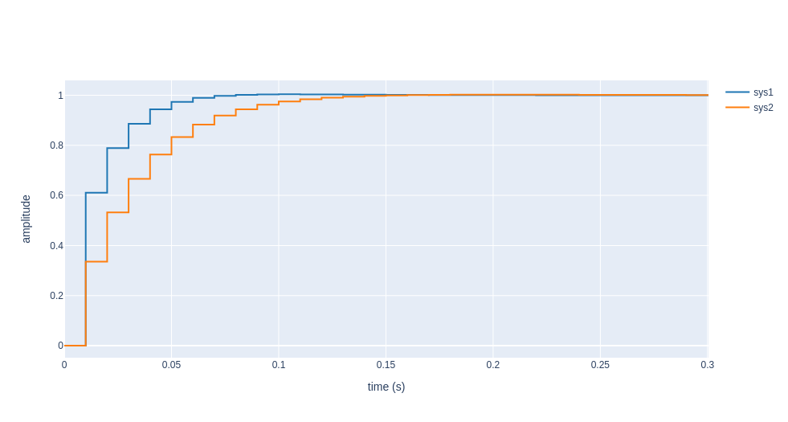
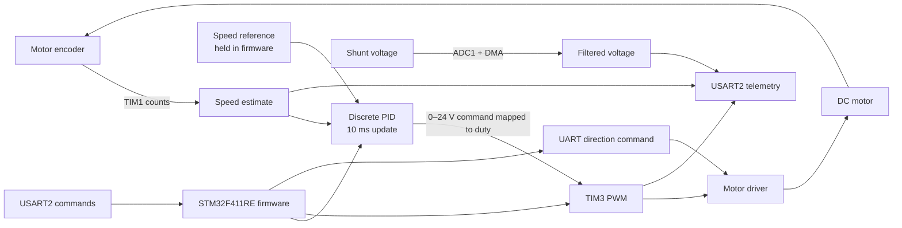
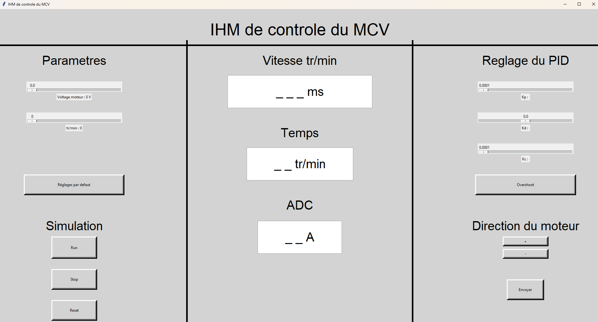
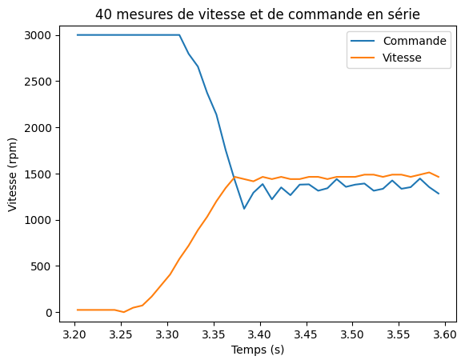
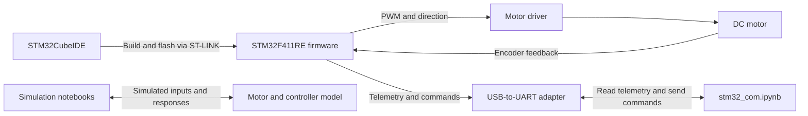

# STM32 IPS — DC motor speed control / Asservissement en vitesse d’un moteur à courant continu

🇬🇧 **EN -** Firmware and supporting notebooks for studying the speed control and measurement of a brushless permanent magnet DC motor with an STM32F411RE.
🇫🇷 **FR -** Firmware et notebooks pour l'étude du contrôle de la vitesse et de la mesure d'un moteur à courant continu à aimants permanents, à l'aide d'un STM32F411RE.

[Back to portfolio](https://github.com/mlmdc) · [Contents / Sommaire](#contents--sommaire) · [Rapport / Report](C-5-article.pdf)

## Contents / Sommaire

- [Overview / Présentation](#overview--présentation)
- [Problem and approach / Problématique et approche](#problem-and-approach--problématique-et-approche)
- [Firmware methods / Méthodes du firmware](#firmware-methods--méthodes-du-firmware)
- [Technical decisions / Choix techniques](#technical-decisions--choix-techniques)
- [Experiments and limits / Expériences et limites](#experiments-and-limits--expériences-et-limites)
- [Getting started / Démarrage](#getting-started--démarrage)
- [Repository structure / Structure du dépôt](#repository-structure--structure-du-dépôt)
- [Acknowledgments / Remerciements](#acknowledgments--remerciements)
- [License](#license)

## Overview / Présentation

🇬🇧 **EN -** This repository combines STM32 firmware with notebooks for modeling a motor and processing serial measurements. On the STM32F411RE, the firmware estimates shaft speed from an incremental encoder, runs a discrete PID controller, and drives a motor-driver input with PWM. An ADC input measures the voltage connected to the current-sense shunt, while USART2 carries telemetry and fixed-size commands. The notebooks contain unloaded and loaded motor simulations, serial acquisition routines, and data post-processing; they are supporting study materials rather than a documented quantitative validation of the firmware.

<br>

🇫🇷 **FR -** Ce dépôt regroupe un firmware STM32 et des notebooks de modélisation du moteur et de traitement de mesures série. Sur le STM32F411RE, le firmware estime la vitesse de l’arbre à partir d’un encodeur incrémental, exécute un PID discret et commande une entrée de l’étage moteur en PWM. Une entrée ADC mesure la tension reliée au shunt de mesure, tandis qu’USART2 transporte la télémétrie et des commandes de taille fixe. Les notebooks comprennent des simulations du moteur à vide et en charge, des routines d’acquisition série et du post-traitement ; ils constituent des supports d’étude, pas une validation quantitative documentée du firmware.

## Problem and approach / Problématique et approche

🇬🇧 **EN -** The firmware brings speed feedback, motor actuation, and auxiliary voltage acquisition together on a microcontroller. Its main inputs are encoder counts, the ADC voltage, a speed reference held by the firmware, and UART commands. A timer schedules the speed estimate and controller update; the controller output is converted to PWM duty cycle, while the shunt-voltage measurement is sent as telemetry. Motor direction is controlled separately from the speed loop.

The notebooks address the same system from two complementary angles: `SIM_Moteur.ipynb` and `SIM_MOTEUR_MOTEURS.ipynb` simulate motor and controller behavior under different model and sampling assumptions; `stm32_com.ipynb` explores serial communication, data acquisition, and post-processing. These models can help formulate experiments, but their outputs do not establish how the physical motor performs.



*Example modeled motor responses under two operating conditions.*

<br>

🇫🇷 **FR -** Le firmware réunit le retour de vitesse, la commande du moteur et une acquisition auxiliaire de tension sur un microcontrôleur. Ses principales entrées sont les comptes de l’encodeur, la tension mesurée par l’ADC, une consigne de vitesse conservée dans le firmware et les commandes UART. Un timer cadence l’estimation de vitesse et la mise à jour du correcteur ; la sortie du correcteur est convertie en rapport cyclique PWM, tandis que la tension du shunt est transmise en télémétrie. Le sens du moteur est commandé séparément de la boucle de vitesse.

Les notebooks abordent le même système sous deux angles complémentaires : `SIM_Moteur.ipynb` et `SIM_MOTEUR_MOTEURS.ipynb` simulent le moteur et le correcteur avec différentes hypothèses de modèle et de période d’échantillonnage ; `stm32_com.ipynb` explore la communication série, l’acquisition et le post-traitement des données. Ces modèles peuvent aider à préparer des expériences, mais leurs résultats ne caractérisent pas à eux seuls le comportement du moteur réel.





*Control interface included in the project materials.*

## Firmware methods / Méthodes du firmware

🇬🇧 **EN :**

- **Speed feedback:** TIM1 counts the quadrature encoder. Every 10 ms, the firmware converts the count change to a speed in RPM using a hard-coded 2,000-counts-per-revolution assumption.
- **Control and actuation:** the PID uses the difference between its stored reference and the absolute measured speed. Its discrete difference equation updates a voltage command, clamped to 0–24 V and mapped linearly to TIM3 channel 1 PWM duty cycle. The direction output is handled separately.
- **Voltage acquisition:** ADC1 channel 0 (PA0) runs with DMA. The firmware keeps eight samples, converts them to a nominal 0–3.3 V range, and applies an exponential moving average with alpha 0.5. This is a filtered voltage reading, not a calibrated current measurement.
- **Serial interface:** USART2 (PA2/PA3) transmits time, ADC voltage, PWM value, and speed. Reception uses 16-byte ASCII frames: the first four bytes identify a command and the remaining bytes contain its value. Implemented commands start or stop the timer interrupt (`0x01`, `0x02`), enable or disable PWM (`0x03`, `0x04`), set duty cycle or voltage (`0x05`, `0x07`), set direction (`0x06`), and write PID gain variables (`0x0B`, `0x0D`, `0x0F`).

<br>

🇫🇷 **FR :**

- **Retour de vitesse :** TIM1 compte les impulsions de l’encodeur en quadrature. Toutes les 10 ms, le firmware convertit la variation du compteur en vitesse (tr/min) en supposant en dur 2 000 comptes par tour.
- **Commande et actionnement :** le PID utilise l’écart entre sa consigne mémorisée et la valeur absolue de la vitesse mesurée. Son équation discrète met à jour une commande de tension, limitée à 0–24 V puis convertie linéairement en rapport cyclique PWM sur le canal 1 de TIM3. Le signal de direction est géré séparément.
- **Acquisition de tension :** ADC1 canal 0 (PA0) fonctionne avec le DMA. Le firmware conserve huit échantillons, les convertit dans une plage nominale de 0 à 3,3 V et applique une moyenne exponentielle avec alpha = 0,5. Il s’agit d’une tension filtrée, pas d’une mesure de courant étalonnée.
- **Liaison série :** USART2 (PA2/PA3) transmet le temps, la tension ADC, la valeur PWM et la vitesse. La réception utilise des trames ASCII de 16 octets : les quatre premiers identifient la commande, les octets suivants portent sa valeur. Les commandes implémentées démarrent ou arrêtent l’interruption du timer (`0x01`, `0x02`), activent ou désactivent le PWM (`0x03`, `0x04`), règlent le rapport cyclique ou la tension (`0x05`, `0x07`), règlent le sens (`0x06`) et écrivent les variables de gain du PID (`0x0B`, `0x0D`, `0x0F`).

## Technical decisions / Choix techniques

🇬🇧 **EN :**

- The firmware is an STM32Cube HAL project generated/configured with STM32CubeMX 6.8.0. TIM1 handles encoder counting, TIM2 schedules the 10 ms control update, TIM3 generates PWM, and USART2 is configured for 115200 baud, 8N1. The `.ioc` file is the source for inspecting the peripheral configuration.
- The controller output is non-negative and limited to 24 V-equivalent command; speed is compared by magnitude and direction is a separate GPIO signal. This is not a signed, bidirectional speed controller.
- UART gain commands update `Kp`, `Ki`, and `Kd`, but the discrete PID coefficients are calculated only during initialization. Changing gains at runtime therefore does not update the coefficients used by the control equation.
- The encoder conversion assumes 2,000 counts per revolution and a 10 ms measurement interval. That assumption must match the encoder, its wiring, and any mechanical gearing before RPM values can be interpreted as calibrated measurements.
- The notebooks use nominal motor-model parameters (including inductance, resistance, motor constant, and inertia) as simulation inputs. The repository does not document these as experimentally identified values. The ADC-to-voltage scaling likewise has no documented calibration of the complete shunt and analog measurement chain.

<br>

🇫🇷 **FR :**

- Le firmware est un projet STM32Cube HAL configuré avec STM32CubeMX 6.8.0. TIM1 compte l’encodeur, TIM2 cadence la mise à jour de commande à 10 ms, TIM3 génère le PWM et USART2 est configuré à 115200 bauds, 8N1. Le fichier `.ioc` permet d’inspecter la configuration des périphériques.
- La sortie du correcteur est non négative et limitée à une commande équivalente à 24 V ; la vitesse est comparée en valeur absolue et le sens est transmis par un GPIO distinct. Il ne s’agit donc pas d’un asservissement bidirectionnel à consigne signée.
- Les commandes UART de gain modifient `Kp`, `Ki` et `Kd`, mais les coefficients du PID discret ne sont calculés qu’à l’initialisation. Un changement de gain à l’exécution ne met donc pas à jour les coefficients utilisés par l’équation de commande.
- La conversion de l’encodeur suppose 2 000 comptes par tour et un intervalle de mesure de 10 ms. Cette hypothèse doit correspondre à l’encodeur, à son câblage et à l’éventuelle réduction mécanique avant d’interpréter les tr/min comme une mesure étalonnée.
- Les notebooks utilisent des paramètres nominaux du modèle moteur (notamment inductance, résistance, constante moteur et inertie) comme entrées de simulation. Le dépôt ne les documente pas comme des valeurs identifiées expérimentalement. De même, l’échelle ADC-tension ne s’accompagne pas d’une calibration documentée de l’ensemble shunt et chaîne analogique.

## Experiments and limits / Expériences et limites

🇬🇧 **EN -** The repository demonstrates an integrated firmware path for encoder feedback, PWM output, ADC voltage acquisition, and UART telemetry. The simulation notebooks contain saved outputs for modeled unloaded/loaded cases and different sample periods; these are results of the notebook models, not measurements of the assembled motor. `stm32_com.ipynb` contains serial measurement and post-processing routines, but the repository does not provide a documented, calibrated data set or a quantitative comparison sufficient to validate controller performance or rank the methods.

There is also an important interface limitation: the PID reference is initialized to zero and is not set by any of the implemented UART commands. UART can change direct PWM/voltage, direction, and gain variables, but it does not provide a speed-reference command. Further validation would require exposing and documenting that reference, checking the encoder scale and sensor calibration, and recording repeatable motor tests with their hardware and load conditions.



*Example serial capture for illustration only; it is not a calibrated validation dataset.*

<br>

🇫🇷 **FR -** Le dépôt met en œuvre une chaîne firmware intégrant retour d’encodeur, sortie PWM, acquisition de tension ADC et télémétrie UART. Les notebooks de simulation contiennent des résultats sauvegardés pour des modèles à vide et en charge et différentes périodes d’échantillonnage ; ce sont des résultats de simulation, pas des mesures du moteur assemblé. `stm32_com.ipynb` contient des routines d’acquisition série et de post-traitement, mais le dépôt ne fournit ni jeu de données étalonné et documenté, ni comparaison quantitative suffisante pour valider les performances du correcteur ou classer les méthodes.

Une limite importante concerne l’interface : la consigne du PID est initialisée à zéro et aucune commande UART implémentée ne permet de la modifier. L’UART peut changer directement le PWM ou la tension, le sens et les variables de gain, mais ne propose pas de commande de consigne de vitesse. Une validation complémentaire nécessiterait d’exposer et documenter cette consigne, de vérifier l’échelle de l’encodeur et l’étalonnage des capteurs, puis d’effectuer des essais moteur répétables en précisant le matériel et la charge.

## Getting started / Démarrage

### Firmware

🇬🇧 **EN -** Requirements: STM32CubeIDE with STM32F4 device support, an STM32F411RE target, an ST-LINK programmer/debugger, and a motor, encoder, and driver wired to the project configuration. For serial communication, use a 3.3 V-compatible USB-to-UART adapter on USART2 (PA2/PA3).

The diagram shows how the hardware and notebooks fit together: the simulation notebooks use a motor model, while `stm32_com.ipynb` can exchange commands and telemetry with the running firmware over UART.



1. Open STM32CubeIDE and import `MCC_IPS/MCC_IPS_FINISHED` using **File → Import → Existing Projects into Workspace**.
2. Build the `MCC_IPS_FINISHED` project, connect the board through ST-LINK, and use **Run → Debug** (or **Run**) to program it.
3. To inspect the peripheral setup, open `MCC_IPS/MCC_IPS_FINISHED/MCC_IPS_FINISHED.ioc` in STM32CubeMX. Regenerate code only when needed because generated files also contain user code.
4. Configure the serial monitor for **115200 baud, 8 data bits, no parity, 1 stop bit (8N1)**.


#### Serial example

The following example sends the 16-byte `0x01` frame, which enables the timer interrupt, then reads one telemetry line. Replace `COM3` with the port assigned to the adapter. The firmware starts the timer during initialization as well; this command re-enables its interrupt if it has been stopped.

```console
python -m pip install pyserial
```

```python
import serial

with serial.Serial("COM3", 115200, timeout=1) as port:
    port.write(b"0x01" + b";" * 12)
    print(port.readline().decode(errors="replace").strip())
```

### Notebooks

🇬🇧 **EN -** The notebooks require Jupyter and import `numpy`, `python-control` (the `control` module), `control_plotly`, `matplotlib`, and/or `pyserial`, depending on the notebook. No dependency manifest or pinned versions are provided. Once a compatible environment is available, start a notebook from the repository root, for example:

```console
python -m jupyter lab SIM_Moteur.ipynb
```

The serial notebook also expects a connected board and a correctly configured serial port.

## Repository structure / Structure du dépôt

| Path | Purpose / Rôle |
| --- | --- |
| `MCC_IPS/MCC_IPS_FINISHED/Core/Src/main.c` | Firmware initialization and 10 ms control callback / Initialisation et callback de commande à 10 ms |
| `MCC_IPS/MCC_IPS_FINISHED/Core/Src/speed.c` | Encoder-based speed estimate / Estimation de vitesse par encodeur |
| `MCC_IPS/MCC_IPS_FINISHED/Core/Src/pidFilter.c` | Discrete PID implementation / Implémentation du PID discret |
| `MCC_IPS/MCC_IPS_FINISHED/Core/Src/pwmCommand.c` | PWM and voltage-to-duty conversion / PWM et conversion tension-rapport cyclique |
| `MCC_IPS/MCC_IPS_FINISHED/Core/Src/current.c` | ADC sampling and voltage filtering / Acquisition ADC et filtrage de tension |
| `MCC_IPS/MCC_IPS_FINISHED/Core/Src/comm.c` | UART telemetry and command parsing / Télémétrie UART et analyse des commandes |
| `MCC_IPS/MCC_IPS_FINISHED/MCC_IPS_FINISHED.ioc` | STM32CubeMX peripheral configuration / Configuration des périphériques STM32CubeMX |
| `SIM_Moteur.ipynb`, `SIM_MOTEUR_MOTEURS.ipynb` | Motor and controller simulations / Simulations du moteur et du correcteur |
| `stm32_com.ipynb` | Serial acquisition and data post-processing / Acquisition série et post-traitement |

## Acknowledgments / Remerciements

**EN** The initial code base was provided by M. Kerhoas: [DC motor control drivers](https://web.enib.fr/~kerhoas/asserv_mcc_drivers.html).

**FR** Le code initial a été fourni par M. Kerhoas : [drivers de commande de moteur à courant continu](https://web.enib.fr/~kerhoas/asserv_mcc_drivers.html).

## License

This project is licensed under the [MIT License](LICENSE).
