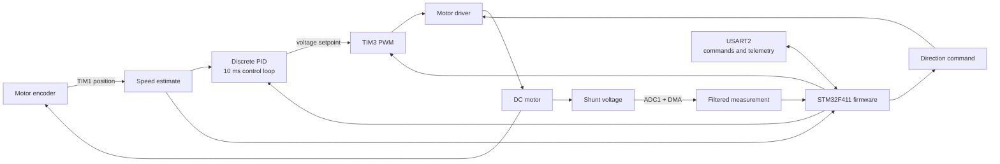

# STM32 IPS — DC motor speed control / Asservissement en vitesse d’un moteur à courant continu

**EN** Firmware for measuring and controlling a brushed DC motor with an STM32F411: encoder-based speed feedback, PWM drive, current-sense voltage acquisition and UART telemetry.

**FR** Firmware de mesure et de commande d’un moteur à courant continu avec un STM32F411 : retour de vitesse par encodeur, commande PWM, acquisition de la tension du shunt et télémétrie UART.

[Back to portfolio / Retour au portfolio](https://github.com/mlmdc) · [Contents](#contents)

## Contents

- [Overview / Présentation](#overview--présentation)
- [Problem & approach / Problématique & approche](#problem--approach--problématique--approche)
- [Technical decisions / Choix techniques](#technical-decisions--choix-techniques)
- [Results & learnings / Résultats--enseignements)
- [Getting started](#getting-started)

## Overview / Présentation

**EN** This project implements the embedded part of a motor-speed control system. It is intended for use with a DC motor, its encoder and a power driver. The firmware samples the encoder and a shunt-connected ADC input, updates a discrete PID controller, drives the motor with PWM and exchanges commands and measurements over USART2. The repository also contains Jupyter notebooks for motor and controller simulations and serial-data analysis.

**FR** Ce projet réalise la partie embarquée d’un système d’asservissement en vitesse. Il est destiné à fonctionner avec un moteur à courant continu, son encodeur et un étage de puissance. Le firmware lit l’encodeur et une entrée ADC reliée au shunt, met à jour un correcteur PID discret, commande le moteur en PWM et échange des commandes et mesures via USART2. Le dépôt contient également des notebooks Jupyter de simulation du moteur et du correcteur, ainsi que d’analyse des données série.



## Problem & approach / Problématique & approche

**EN** The project needed to combine motor actuation with repeatable speed and current-sense acquisition on a resource-constrained microcontroller. The implementation uses hardware timers and interrupts to schedule measurements and control, and a UART link to expose measurements and accept commands without requiring a separate host-side control application.

**FR** Le projet devait associer la commande du moteur à des mesures de vitesse et de courant reproductibles sur un microcontrôleur à ressources limitées. L’implémentation s’appuie sur les timers et interruptions matériels pour cadencer les mesures et la commande, et sur une liaison UART pour transmettre les mesures et recevoir des commandes sans application de contrôle hôte dédiée.

## Technical decisions / Choix techniques

- **EN:** STM32F411RE with STM32Cube HAL and a CubeMX `.ioc` project; this keeps peripheral setup and the generated Eclipse-based project together.
  **FR :** STM32F411RE avec STM32Cube HAL et projet CubeMX `.ioc` ; la configuration des périphériques et le projet Eclipse généré restent regroupés.
- **EN:** TIM1 runs the quadrature encoder, TIM3 generates PWM, TIM2 schedules the 10 ms control step, and USART2 provides a 115200 baud serial interface.
  **FR :** TIM1 lit l’encodeur en quadrature, TIM3 génère le PWM, TIM2 cadence la boucle à 10 ms et USART2 fournit une liaison série à 115200 bauds.
- **EN:** ADC1 uses DMA for shunt-voltage sampling; eight samples are smoothed with an exponential moving average. This reduces per-sample processing, but the firmware does not document a calibrated conversion to amperes.
  **FR :** ADC1 utilise le DMA pour acquérir la tension du shunt ; huit échantillons sont lissés par moyenne exponentielle. Cela limite le traitement par échantillon, mais le firmware ne documente pas de conversion étalonnée en ampères.
- **EN:** The PID is implemented as a discrete difference equation and its output is clamped to 0–24 V before conversion to PWM duty cycle. This matches the one-direction voltage command implemented in the firmware; bidirectional drive and anti-windup are not implemented in this controller.
  **FR :** Le PID est écrit sous forme d’équation aux différences et sa sortie est limitée à 0–24 V avant conversion en rapport cyclique PWM. Ce choix correspond à la commande de tension dans un seul sens présente dans le firmware ; cette implémentation ne gère ni la commande bidirectionnelle ni l’anti-windup.

## Results & learnings

**EN**

- The firmware integrates encoder speed measurement, shunt-voltage acquisition, PWM/direction control, a discrete PID and UART telemetry in one STM32Cube project.
- The notebooks provide a starting point for motor/controller simulation and serial-data processing; the repository does not report quantitative bench validation or controller-performance results.
- Current measurement is still expressed as a filtered ADC voltage, not calibrated amperes. Further work includes characterizing the shunt and sensor chain, validating the control response on the motor, and documenting the UART protocol and repeatable test results.

**FR**

- Le firmware regroupe dans un même projet STM32Cube la mesure de vitesse par encodeur, l’acquisition de la tension du shunt, la commande PWM et direction, le PID discret et la télémétrie UART.
- Les notebooks constituent une base de simulation du moteur et du correcteur, ainsi que de traitement des données série ; le dépôt ne présente pas de validation expérimentale quantitative ni de résultats de performance du correcteur.
- La mesure de courant reste une tension ADC filtrée, sans conversion étalonnée en ampères. Les suites envisagées sont la caractérisation du shunt et de la chaîne de mesure, la validation de la réponse du moteur et la documentation du protocole UART et de résultats de tests reproductibles.

## Getting started

### Requirements

- STM32CubeIDE with STM32F4 device support.
- An STM32F411RE target, an ST-LINK programmer/debugger, and the motor, encoder and driver hardware wired for the project configuration.
- A 3.3 V USB-to-UART adapter or equivalent serial connection to USART2 (PA2/PA3), plus a serial monitor for the optional telemetry example.

### Build and flash

1. Clone this repository and open STM32CubeIDE.
2. Import `MCC_IPS/MCC_IPS_FINISHED` using **File → Import → Existing Projects into Workspace**.
3. Build the `MCC_IPS_FINISHED` project, connect the target through ST-LINK, then use **Run → Debug** (or **Run**) to program it.
4. For serial access, connect USART2 at **115200 baud, 8 data bits, no parity, 1 stop bit (8N1)**.

The `.ioc` file was created with STM32CubeMX 6.8.0. It can be opened to inspect the peripheral configuration; regenerate code only when needed, since generated files contain user code.

### Example: start telemetry

The firmware receives fixed-size 16-byte ASCII command frames. With `pyserial` installed and the board connected to `COM3`, this sends the `0x01` start command and reads one telemetry line:

```console
python -m pip install pyserial
```

```python
import serial

with serial.Serial("COM3", 115200, timeout=1) as port:
    port.write(b"0x01" + b";" * 12)
    print(port.readline().decode(errors="replace").strip())
```

The firmware also defines command identifiers for stopping the periodic loop (`0x02`), enabling/disabling PWM (`0x03`/`0x04`), setting duty cycle (`0x05`), setting direction (`0x06`), setting voltage (`0x07`) and writing the PID gain variables (`0x0B`, `0x0D`, `0x0F`). The gain commands currently do not recalculate the discrete PID coefficients. See `MCC_IPS/MCC_IPS_FINISHED/Core/Src/comm.c` for the current frame parsing and command behavior.

## Acknowledgment

The initial code base was provided by M. Kerhoas: [DC motor control drivers](https://web.enib.fr/~kerhoas/asserv_mcc_drivers.html).
